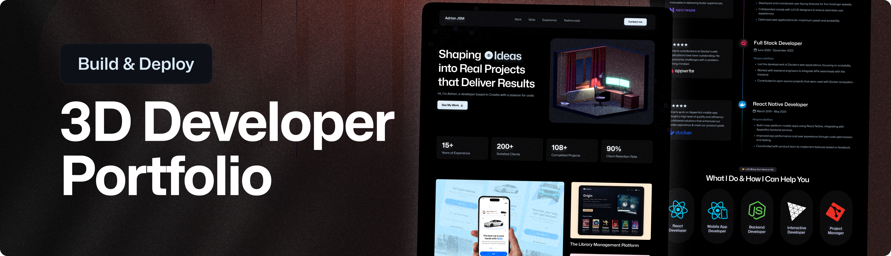
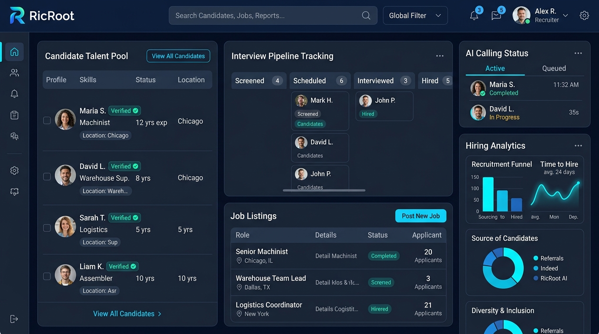

<div align="center">

# 🌐 Shivam Sakre // 3D Interactive Portfolio & Systems Architecture

<p align="center">
  <b>Elite Full-Stack Developer • Technical Architect • Interactive 3D Web & Systems Engineer</b>
</p>

<p align="center">
  <a href="https://shivamsakre.in" target="_blank">
    
  </a>
  <a href="https://github.com/shivamsakre10-oss/portfolio" target="_blank">
    
  </a>
  <a href="https://linkedin.com/in/shivam-sakre" target="_blank">
    
  </a>
  <a href="mailto:shivamsakre10@gmail.com">
    
  </a>
</p>

<p align="center">
  
  
  
  
  
  
  
  
  
  
  
</p>

<br />

<a href="https://shivamsakre.in" target="_blank">
  
</a>

</div>

---

## 📑 Table of Contents

- [Overview](#-overview)
- [Key Features & Innovations](#-key-features--innovations)
- [Featured Projects](#-featured-projects)
- [Technical Architecture](#-technical-architecture)
- [Tech Stack](#-tech-stack)
- [Repository Structure](#-repository-structure)
- [Getting Started](#-getting-started)
  - [Prerequisites](#prerequisites)
  - [Installation](#installation)
  - [Environment Setup](#environment-setup)
  - [Running the Project](#running-the-project)
- [API Endpoints](#-api-endpoints)
- [Deployment](#-deployment)
- [Author & Contact](#-author--contact)
- [License](#-license)

---

## ⚡ Overview

Welcome to the official repository for **Shivam Sakre's Portfolio** — an ultra-modern, cyberpunk-inspired 3D web experience engineered with **React 19**, **Three.js / React Three Fiber**, **Tailwind CSS v4**, **Node.js / Express**, and **Google Gemini AI**.

Designed from the ground up for speed, visual immersion, and real-world engineering depth, this platform serves as both a high-fidelity creative showcase and a production-grade full-stack application featuring:
- **Interactive 3D WebGL Scenes** with responsive orbiting and physics-based lighting.
- **Embedded AI Portfolio Copilot** backed by Google's Gemini LLM with voice dictation (STT) and synthesized speech (TTS).
- **Interactive Cyber Terminal** simulating a real-time developer CLI with hardware telemetry and interactive commands.
- **Interactive Project Scope & Cost Estimator** for calculating engineering sprint schedules and architecture requirements.
- **Robust Email Transmission System** with dual-mode Nodemailer SMTP, Vercel serverless integration, and automatic client receipt confirmations.

---

## 🚀 Key Features & Innovations

### 1. 🌌 3D Holographic WebGL Experience
- Built with **Three.js**, **@react-three/fiber**, and **@react-three/drei**.
- Dynamic GLTF models, bloom postprocessing, responsive canvas camera choreographies, and particle mesh backdrops.
- Optimized for smooth 60fps rendering across desktop and mobile devices.

### 2. 🤖 Gemini-Powered AI Portfolio Copilot
- Intelligent assistant integrated via `/api/copilot` leveraging Google Gemini.
- Grounded with real knowledge about Shivam's career history, work at **Veracity Supply Chain Limited** and **Ypsilon IT Solutions**, core competencies, and project deliverables.
- Interactive action buttons: one-click resume download, WhatsApp chat launcher, and deep-link section navigation.
- Native speech recognition (`webkitSpeechRecognition`) for voice input and Web Speech API synthesis for spoken audio output.

### 3. 💻 Interactive Cyber Terminal (`Terminal.jsx`)
- Full UNIX-inspired developer shell embedded inside the webpage.
- Supported CLI commands: `help`, `skills`, `projects`, `exp`, `contact`, `whoami`, `clear`, `top` (live CPU/RAM/traffic telemetry simulation), and theme controls.
- Fast-action pill buttons for quick queries without manual typing.

### 4. 📊 Project Scope & Sprint Estimator (`ScopeEstimator.jsx`)
- Dynamic architectural calculator for prospective clients and engineering managers.
- Select project archetypes (*3D Web Experience*, *Full-Stack SaaS*, *Fintech API*, *AI Workflows*, *Full MVP*).
- Toggle feature add-ons (custom shaders, RBAC auth, payment gateways, automated CI/CD) to compute estimated delivery days, complexity tiers, and recommended architectures.

### 5. 🎵 Synthesized Web Audio Soundscapes (`CareerTrajectory.jsx`)
- Interactive career milestones with pitch-mapped harmonic tones synthesized entirely client-side using the **Web Audio API**.
- Frequency mapping: Domain (587.33 Hz), Backend (659.25 Hz), Lifecycle (783.99 Hz), and Database (554.37 Hz).

### 6. 📬 Secure Contact Transmission Protocol (`Contact.jsx`)
- Dual-channel message processing (local Node.js Express server + Vercel serverless functions in `/api/contact`).
- Automated, beautifully styled HTML receipt confirmations dispatched directly to clients upon submission (`/api/send-receipt`).
- Rate limiting, IP tracking, honeypot spam protection, and real-time validation.

---

## 🏆 Featured Projects

<div align="center">

### 1. [RicRoot — Workforce Management Platform](https://ricroot.in)
*Connecting employers with verified blue & grey-collar workforce talent at scale.*

<a href="https://ricroot.in" target="_blank">
  
</a>

</div>

- **Role:** Full-Stack Development & Architecture
- **Tech Stack:** React.js, Node.js, Express.js, MongoDB, RESTful APIs
- **Key Highlights:**
  - Role-based job search by location, shifts, and compensation packages.
  - Automated AI candidate screening calling workflows to pre-qualify applicants.
  - Candidate verification pipelines and verified digital profile systems.
  - Integrated interview scheduler with automated calendar meeting links.
  - Bulk hiring drives management for high-volume enterprise workforce intake.
- **Live URL:** [ricroot.in](https://ricroot.in)

---

### 2. SB Work — Freelancer Marketplace
*A unified platform connecting businesses with vetted independent talent.*

- **Tech Stack:** React.js, Node.js, Express.js, MongoDB, JWT Authentication
- **Key Highlights:**
  - Dual-role authentication separating client postings from freelancer bids.
  - Responsive dashboards for real-time project publishing, discovery, and proposal reviews.
  - Role-based authorization (RBAC) secured via JWT tokens and encrypted password stores.
  - Scalable MongoDB schema design for fast search indexing across listings and proposals.

---

### 3. Online Quiz Web Application
*Interactive web-based assessment engine designed for college and academic examinations.*

- **Tech Stack:** React.js, Node.js, Express.js, MongoDB
- **Key Highlights:**
  - Subject-wise quiz generation with timers and automated score tabulation.
  - Administrative back-office panel to manage question banks and evaluate student score histories.
  - Secure role-guarded routes preventing tampering during live assessment sessions.

---

## 🛠️ Technical Architecture

```
┌────────────────────────────────────────────────────────────────────────┐
│                          CLIENT (Vite + React 19)                      │
│                                                                        │
│  ┌──────────────────┐  ┌──────────────────┐  ┌──────────────────────┐  │
│  │ 3D Canvas / R3F  │  │ Cyber Terminal   │  │ Portfolio Copilot    │  │
│  │ Three.js Models  │  │ Interactive CLI  │  │ Voice STT / TTS      │  │
│  └─────────┬────────┘  └────────┬─────────┘  └──────────┬───────────┘  │
│            │                    │                       │              │
│  ┌─────────┴────────────────────┴───────────────────────┴───────────┐  │
│  │          Responsive Cyber-Industrial UI (Tailwind CSS v4)        │  │
│  └──────────────────────────────────┬───────────────────────────────┘  │
└─────────────────────────────────────┼──────────────────────────────────┘
                                      │ REST API Requests
                                      ▼
┌────────────────────────────────────────────────────────────────────────┐
│                 BACKEND / TRANSMISSION LAYER (Node.js)                 │
│                                                                        │
│   Express Server (server.js)  OR  Vercel Serverless Functions (/api)  │
│                                                                        │
│      ├── /api/health          -> Server status & SMTP diagnostic       │
│      ├── /api/copilot         -> Google Gemini 1.5/2.0 API gateway     │
│      ├── /api/contact         -> Inbound client transmission & mailer  │
│      └── /api/send-receipt    -> Outbound client acknowledgment receipt│
└───────────────────────┬───────────────────────────────┬────────────────┘
                        │                               │
                        ▼                               ▼
        ┌───────────────────────────────┐   ┌────────────────────────────┐
        │       Google Gemini API       │   │    Nodemailer / SMTP       │
        │  (Portfolio Copilot Engine)   │   │  (Gmail / Resend / Brevo)  │
        └───────────────────────────────┘   └────────────────────────────┘
```

---

## 💻 Tech Stack

| Domain | Technologies |
| :--- | :--- |
| **Frontend Core** | React 19, JavaScript (ES6+), Vite 6, HTML5, CSS3 |
| **3D & Animation** | Three.js, React Three Fiber (`@react-three/fiber`), Drei (`@react-three/drei`), GSAP (`@gsap/react`), Postprocessing |
| **Styling & UI** | Tailwind CSS v4, Lucide React Icons, Google Fonts (Hanken Grotesk, JetBrains Mono, Space Grotesk) |
| **Backend & Runtime** | Node.js (v20+), Express 5, CORS, Dotenv |
| **AI Integration** | Google Gemini API (Portfolio Copilot intelligent knowledge engine) |
| **Email Protocol** | Nodemailer (Gmail SMTP, Resend, Brevo, or transactional SMTP) |
| **Database & ODM** | MongoDB, Mongoose |
| **DevOps & Tooling** | Vercel (Serverless Functions), Git, ESLint, npm |

---

## 📁 Repository Structure

```plaintext
portfolio/
├── api/                       # Vercel Serverless API functions
│   ├── contact.js             # Serverless contact submission handler
│   ├── copilot.js             # Serverless Gemini AI gateway
│   ├── health.js              # Serverless health & diagnostic probe
│   └── send-receipt.js        # Serverless auto-receipt dispatcher
├── public/                    # Static public assets
│   ├── images/                # Project mockups, logos, showcase cards
│   ├── models/                # Optimized GLTF/GLB 3D binary models
│   └── Shivam_Sakre_Resume.pdf# Downloadable PDF resume
├── server/                    # Standalone Node.js Express backend
│   ├── emailService.js        # Nodemailer SMTP transport & HTML templates
│   ├── geminiService.js       # Gemini API client & contextual knowledge agent
│   ├── server.js              # Express app entry point (port 5000)
│   └── testEmail.js           # CLI diagnostic script for testing SMTP
├── src/                       # Frontend React application
│   ├── components/            # Reusable components (HologramScene, Copilot, NavBar, etc.)
│   ├── constants/             # Profile constants, navigation links, abilities
│   ├── context/               # Global state (ThemeContext, etc.)
│   ├── sections/              # Page sections (Hero, Showcase, Terminal, Scope, Contact, etc.)
│   ├── utils/                 # Audio synthesis, smooth scroll utilities
│   ├── App.jsx                # Main application orchestrator
│   ├── index.css              # Tailwind CSS v4 directives & typography tokens
│   └── main.jsx               # React DOM entry point
├── .env.example               # Environment variables template
├── index.html                 # Single page application HTML shell
├── package.json               # Project manifest, scripts, and dependencies
└── vite.config.js             # Vite configuration with Tailwind CSS integration
```

---

## 🚀 Getting Started

Follow these steps to run the complete full-stack portfolio on your local machine.

### Prerequisites

Ensure you have the following installed:
- [Node.js](https://nodejs.org/) (Version 18.x or higher)
- [Git](https://git-scm.com/)
- [npm](https://www.npmjs.com/) (bundled with Node.js)

### Installation

1. **Clone the repository:**
   ```bash
   git clone https://github.com/shivamsakre10-oss/portfolio.git
   cd portfolio
   ```

2. **Install project dependencies:**
   ```bash
   npm install
   ```

### Environment Setup

Create a `.env` file in the root directory by copying the example file:

```bash
cp .env.example .env
```

Configure your credentials inside `.env`:

```env
# Server Port
PORT=5000

# Recipient for contact form transmissions
CONTACT_DESTINATION_EMAIL=shivamsakre10@gmail.com

# Google Gemini API Key (for Portfolio Copilot AI)
# Get your free key at: https://aistudio.google.com/
GEMINI_API_KEY=your_gemini_api_key_here

# SMTP Configuration for Contact Form
SMTP_HOST=smtp.gmail.com
SMTP_PORT=465
SMTP_SECURE=true
SMTP_USER=your_email@gmail.com
SMTP_PASS=your_16_character_app_password
SMTP_FROM="Shivam Sakre Transmission" <your_email@gmail.com>
```

> [!TIP]
> **Gmail Setup:** Enable 2-Step Verification on your Google Account, generate an [App Password](https://myaccount.google.com/apppasswords), and paste the 16-character string into `SMTP_PASS`.

### Running the Project

#### 1. Frontend Development Server (Vite)
Runs the React client with Hot Module Replacement (HMR):
```bash
npm run dev
```
Open [http://localhost:5173](http://localhost:5173) in your browser.

#### 2. Full-Stack Backend Server
Runs the standalone Express backend handling `/api/contact`, `/api/copilot`, and `/api/health`:
```bash
npm run server
```
The server will start on [http://localhost:5000](http://localhost:5000).

#### 3. Test Email Diagnostics
Verify that your SMTP credentials work before sending real form submissions:
```bash
npm run test-email
```

#### 4. Build for Production
Bundle the optimized client application:
```bash
npm run build
```

Preview the production build locally:
```bash
npm run preview
```

---

## 📡 API Endpoints

The backend provides the following REST endpoints (supported both via Express and Vercel serverless routes):

| Method | Endpoint | Description |
| :--- | :--- | :--- |
| `GET` | `/api/health` | Health check & SMTP connection diagnostic status |
| `POST` | `/api/contact` | Submits a new transmission and delivers an email notification |
| `POST` | `/api/send-receipt` | Dispatches an automatic confirmation receipt to the visitor's email |
| `POST` | `/api/copilot` | Queries the Google Gemini AI assistant for interactive answers |

---

## 🌐 Deployment

### Deploying to Vercel (Recommended)
This repository is pre-configured for seamless Vercel deployment:
1. Push your code to your GitHub repository.
2. Import the project on [Vercel](https://vercel.com).
3. Set your environment variables (`GEMINI_API_KEY`, `SMTP_USER`, `SMTP_PASS`, `CONTACT_DESTINATION_EMAIL`, etc.) in the Vercel project settings.
4. Deploy! The frontend builds automatically, and files in `/api` are treated as serverless functions.

### Deploying with Node / Docker / VPS
If hosting on a VPS (Ubuntu/Debian) or PaaS (Render, Railway, Fly.io):
1. Run `npm run build` to generate the production `dist/` directory.
2. Start the Express server with `npm start` or `npm run server`.
3. The server will automatically serve the static `dist/` build and handle all `/api` requests on the assigned port.

---

## 👨‍💻 Author & Contact

**Shivam Sakre**  
*Software Developer & Technical Architect*  
*Veracity Supply Chain Limited • Ahmedabad, India*

- 🌐 **Portfolio:** [https://shivamsakre.in](https://shivamsakre.in)
- 💼 **LinkedIn:** [linkedin.com/in/shivam-sakre](https://linkedin.com/in/shivam-sakre)
- 🐙 **GitHub:** [github.com/shivamsakre10-oss](https://github.com/shivamsakre10-oss)
- ✉️ **Email:** [shivamsakre10@gmail.com](mailto:shivamsakre10@gmail.com)
- 📱 **WhatsApp:** [+91 97703 75191](https://wa.me/919770375191)

---

## 📄 License

This project is licensed under the [MIT License](LICENSE). Feel free to use it as inspiration for your own portfolio builds.

<div align="center">
  <sub>Engineered with precision by Shivam Sakre • Built for the modern web</sub>
</div>
